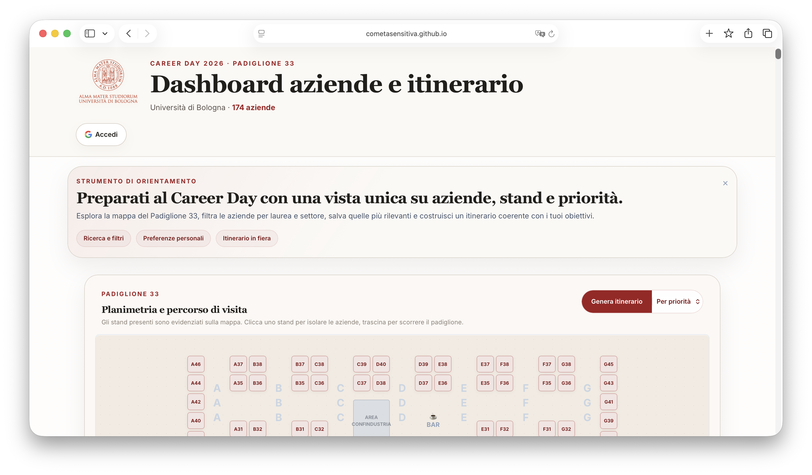

# Career Day UniBo 2026

[English](README.md) · **Italiano**

Una dashboard che ho costruito per preparare la mia visita al Career Day dell’Università di Bologna: esplorare **174 aziende**, salvare le preferite e pianificare un giro sulla mappa degli stand.

**[Apri la dashboard](https://cometasensitiva.github.io/Career-Day-UniBo-2026/)**



L’ho costruita per me e poi proposta all’università. È un progetto studentesco indipendente. Il dataset descrive **l’evento 2026**, anziché le offerte di lavoro attuali; informazioni aziendali e riepiloghi AI vanno verificati sulle fonti.

## Cosa fa

- Ricerca e filtri per settore, corso di laurea e preferenze personali.
- Preferiti, itinerario tra gli stand ed esportazione di aziende selezionate o immagine della mappa.
- Sincronizzazione delle preferenze tramite Firebase nel nodo personale dell’utente autenticato.
- Riepiloghi delle aziende con una chiave API Gemini salvata nel browser dell’utente.

## Avvio locale

Richiede **Node.js 20 o successivo** e **Python 3.11 o successivo**. Da un clone pulito:

```sh
git clone https://github.com/CometaSensitiva/Career-Day-UniBo-2026.git
cd Career-Day-UniBo-2026
npm ci
npm run build:tailwind
python3 -m http.server 8000
```

Apri [localhost:8000](http://127.0.0.1:8000/). L’accesso Firebase richiede un dominio autorizzato nel progetto Firebase; la consultazione del dataset non richiede l’accesso. Per la funzione Gemini serve la tua chiave API.

## Idee

Aggiornare dataset e mappa degli stand ogni anno, conservando l’edizione precedente. La [guida all’aggiornamento dati](docs/DATA_UPDATE_WORKFLOW.md) descrive scraping, loghi e validazione. Per una nuova edizione, prepara la mappa e verifica l’URL della fonte prima di avviare l’aggiornamento:

```sh
python3 tools/update_dashboard.py --year 2027 --mapping-file tools/stand_map_2027.json --dry-run
```

Il file della mappa 2027 va creato prima. Un’edizione futura potrebbe permettere di scegliere l’anno nella dashboard, mantenendo l’URL attuale di GitHub Pages.

## Per sviluppatori

```sh
npm run check:js
npm run check:py
npm run validate:data
```

La CI genera anche il CSS; Dependabot è configurato. Alcune aziende non hanno stand confermato, email o sito HTTPS. Il validatore segnala queste lacune.

[Documentazione](docs/README.md) · [Architettura](docs/ARCHITECTURE.md) · [Licenza MIT](LICENSE). Loghi, marchi e dati di terze parti mantengono i rispettivi diritti.
